

# epinv1

**Oyun hesabı, e-pin ve dijital ürün satışı için PHP tabanlı, yönetim panelli e-ticaret altyapısı**

> Bu depo yalnızca tanıtım amaçlıdır, kaynak kod içermez. Ekran görüntülerindeki kullanıcılar ve siparişler örnek veridir.

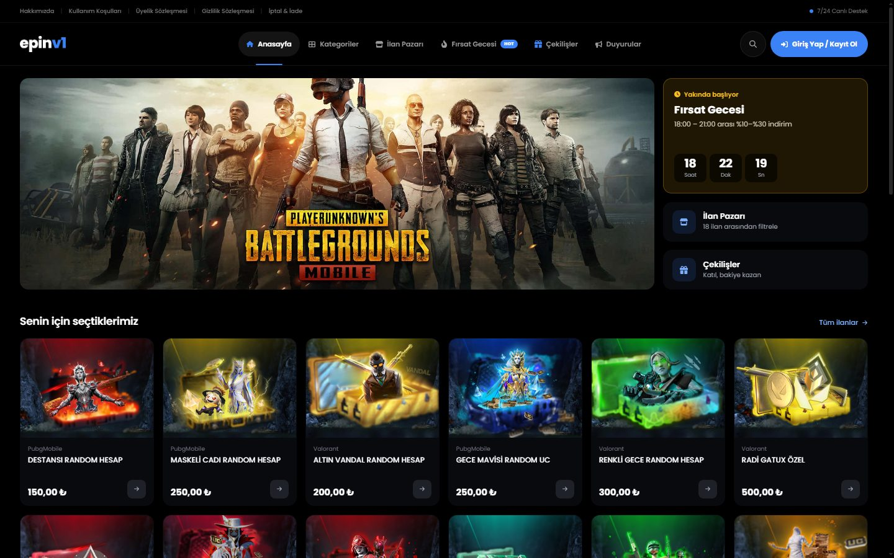

## Öne çıkanlar

- **Otomatik teslimat:** Satın alınan ürünün kodu anında hesaba teslim edilir.
- **Bakiye sistemi:** Shopier ile kartla ödeme, havale/EFT bildirimi ve kupon kodu.
- **Kampanyalar:** Süreli Fırsat Gecesi indirimleri, çekilişler, bonuslar, seviye ödülleri ve referans sistemi.
- **Tam yönetim paneli:** Mağazanın her parçası tek panelden yönetilir.
- **Mobil uyumlu:** Site ve panel; telefon, tablet ve masaüstüne uyum sağlar.

## Ekran görüntüleri

### Mağaza

| İlan Pazarı | Ürün Detayı |
|---|---|
| 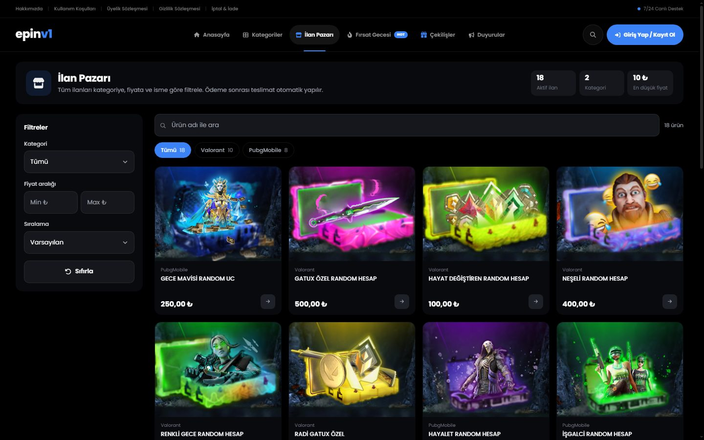 | 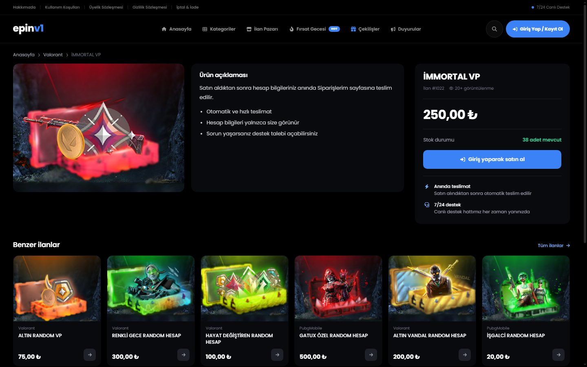 |
| **Giriş** | **Kayıt** |
| 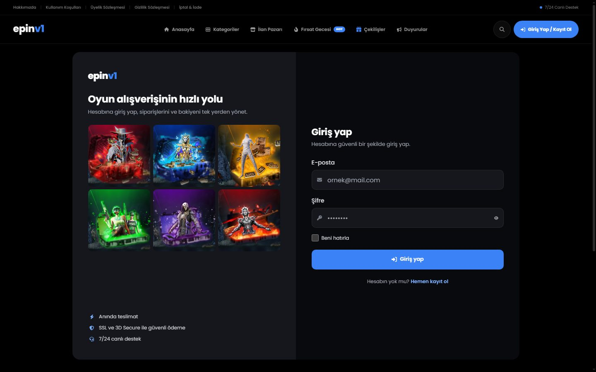 | 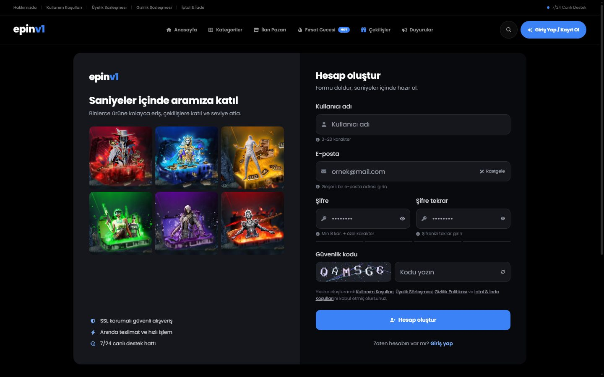 |

### Üye hesabı

| Siparişlerim | Bakiye Yükle |
|---|---|
| 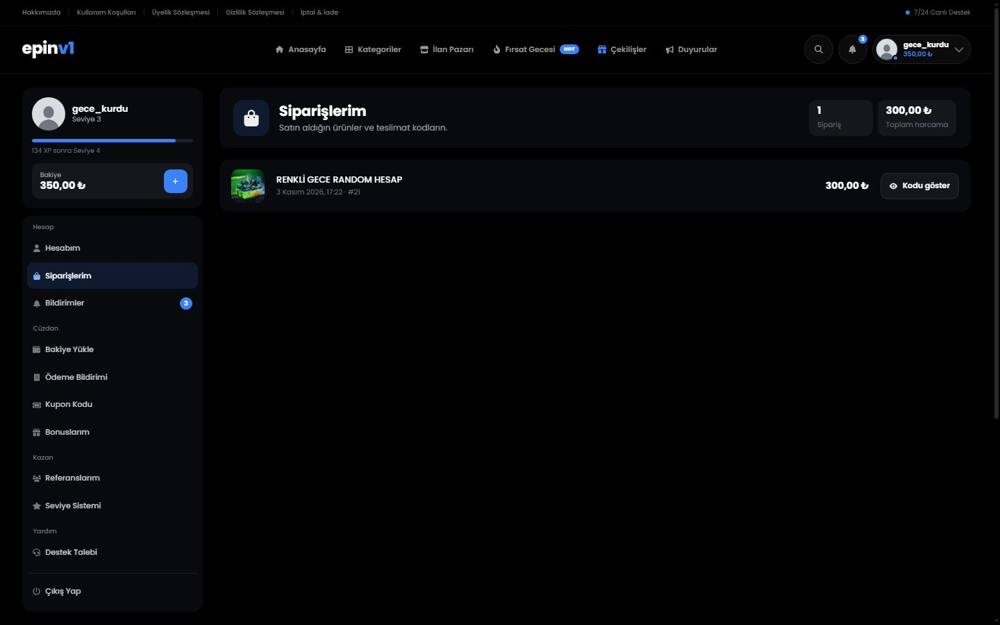 | 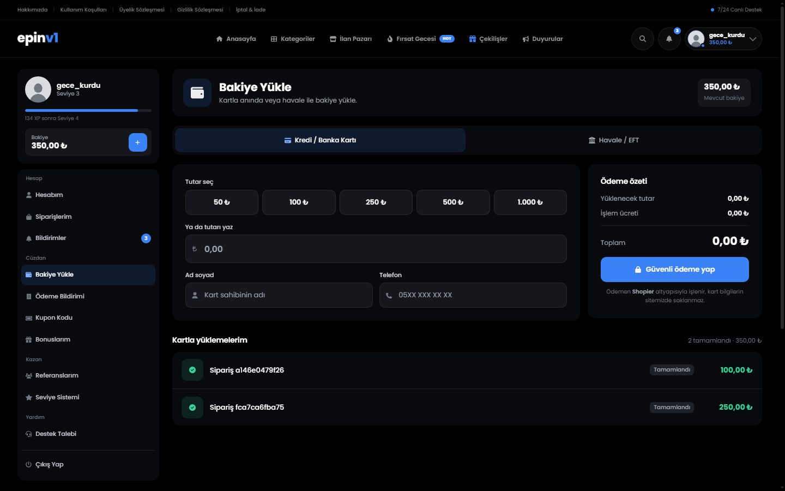 |
| **Çekilişler** | **Mobil görünüm** |
| 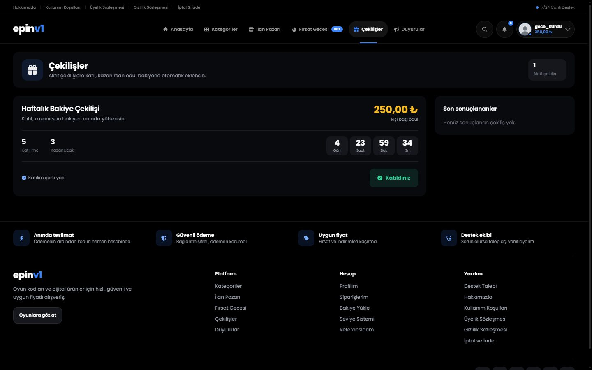 | 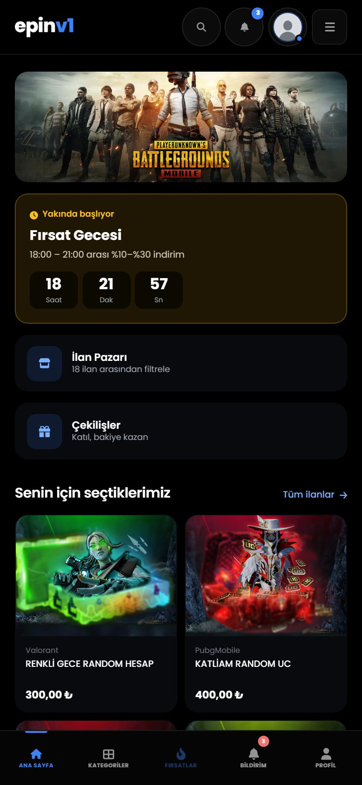 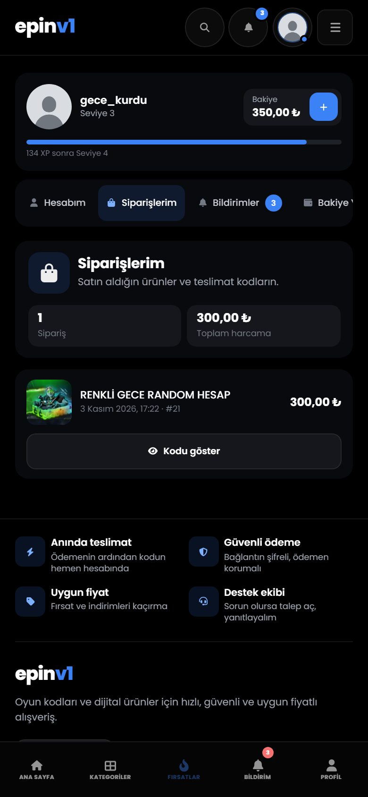 |

### Yönetim paneli

| Ana Sayfa | İstatistikler |
|---|---|
| 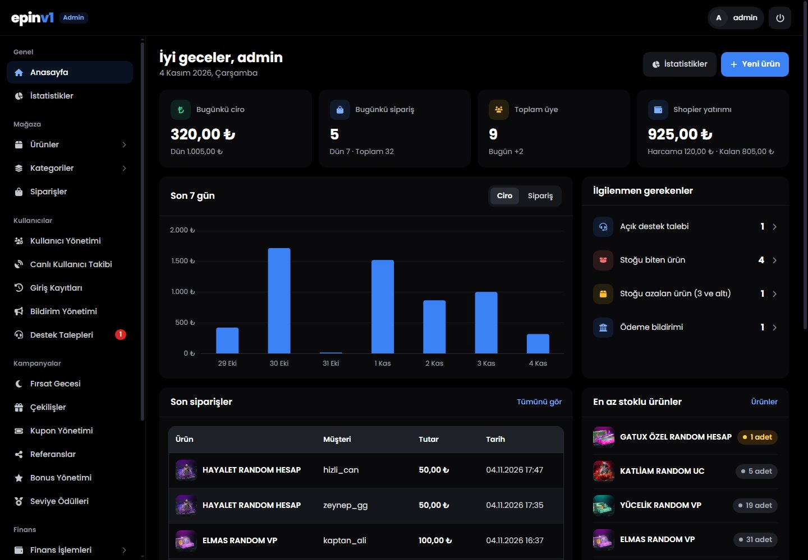 | 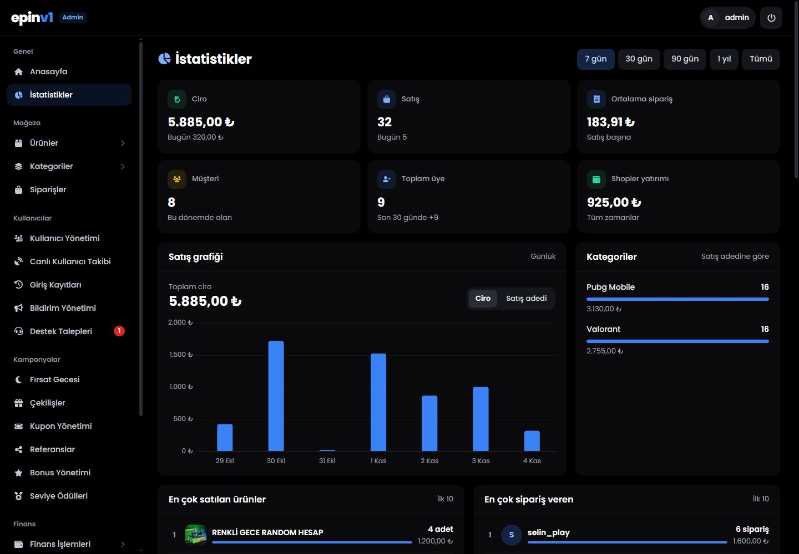 |
| **Ürünler** | |
| 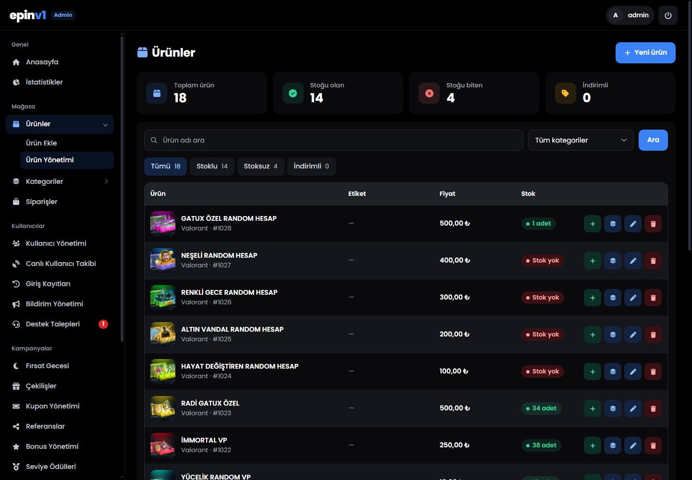 | |

## Özellikler

**Mağaza ve üyelik**

- Kategori, ilan pazarı, ürün arama ve filtreleme
- Siparişler, bildirimler, destek talepleri ve giriş geçmişi
- Duyurular ve yorumlar
- Sözleşme ve yasal sayfalar

**Yönetim paneli**

- Satış grafikleri, istatistikler ve "ilgilenmen gerekenler" listesi
- Ürün, stok, kategori, sipariş ve üye yönetimi
- Çekiliş, kupon, bonus, seviye ödülü, referans ve Fırsat Gecesi yönetimi
- Canlı kullanıcı takibi, giriş kayıtları, destek talepleri ve toplu bildirim
- Site ayarları, sayfa yönetimi, slider, banka bilgileri ve bakım modu

## Güvenlik

| Alan | Önlem |
|---|---|
| **SQL enjeksiyonu** | Kullanıcı girdileri parametreli sorgularla (PDO) işlenir |
| **XSS** | Çıktılar kaçışlanır, bildirim bağlantıları doğrulanır |
| **Şifreler** | Tek yönlü `password_hash` ile saklanır |
| **Oturum** | `HttpOnly`, `Secure` ve `SameSite` çerezleri; girişte oturum kimliği yenilenir |
| **Kaba kuvvet** | Veritabanı tabanlı giriş denemesi sınırı; kayıtta sunucuda üretilen görsel captcha |
| **CSRF** | Yönetim panelindeki tüm işlemlerde token doğrulaması |
| **Yetkilendirme** | Panel ve hesap sayfalarında sunucu tarafında rol ve sahiplik kontrolü |
| **Para işlemleri** | Satın alma ve çekiliş ödemeleri satır kilitli işlemlerle yürütülür, eşzamanlı isteklerde çift harcama engellenir |
| **Ödeme** | Shopier bildirimleri HMAC imzasıyla doğrulanır |
| **Dosya yükleme** | Uzantı ve içerik kontrolü; yükleme klasöründe betik çalıştırma kapalıdır |
| **Gizli bilgiler** | Anahtarlar `.env` dosyasında tutulur, bu dosya web'den erişilemez |

## Teknolojiler

PHP 8 · MariaDB (PDO) · Apache · HTML, CSS, JavaScript · Chart.js · Quill · DataTables · Shopier

## Satın alma

Satın almak veya bilgi almak için [GitHub profilimdeki](https://github.com/manly404) Telegram adresinden bana ulaşabilirsiniz.
